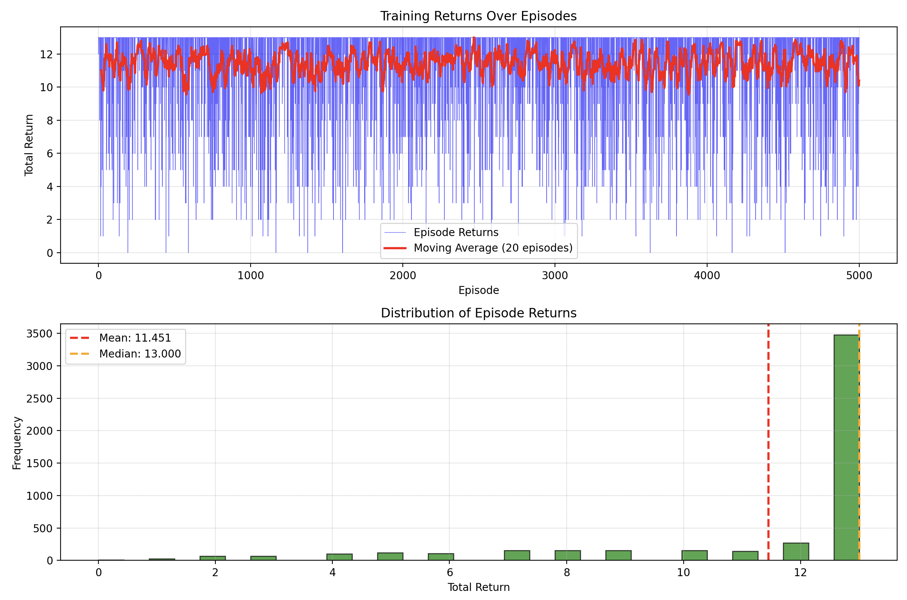
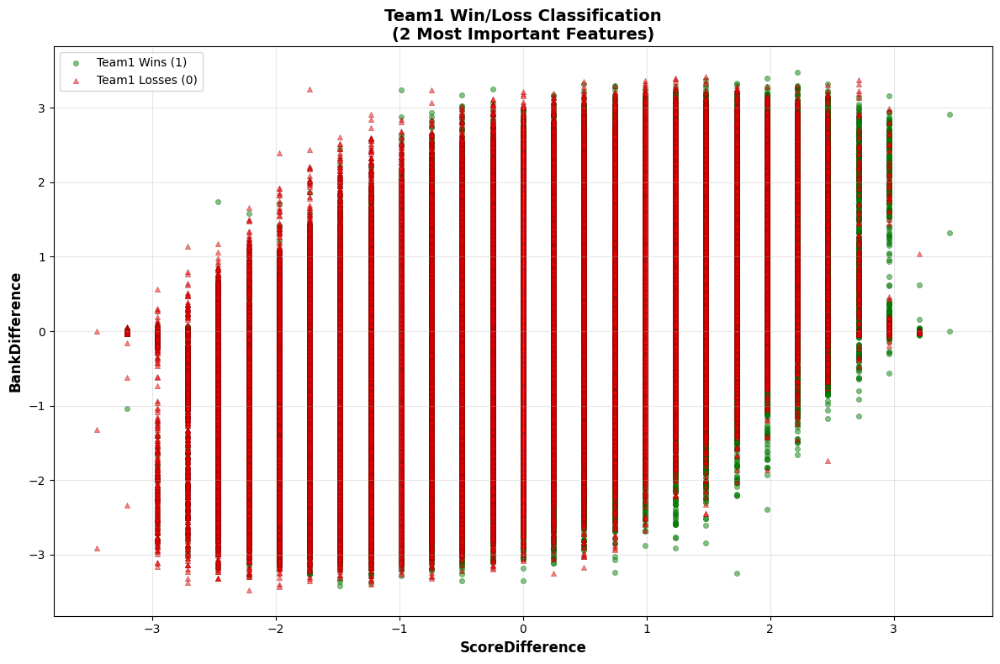
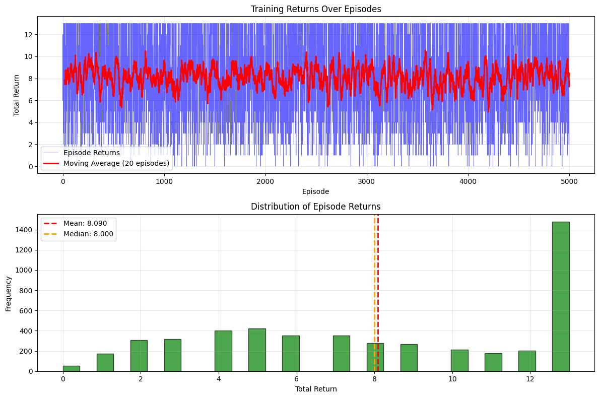

# Valorant Economy Agent (CSCI 146 Project)

A reinforcement-learning agent that learns when to eco, semi-buy, or full-buy in Valorant. Round outcomes come from a logistic regression fitted to about 305,000 real pro rounds.



- Return = rounds won by Team 1 in one simulated match. 13 means Team 1 won the match.
- In this saved run the agent averages 11.45 rounds and wins most matches.

## How it works

1. Load pro match data from Kaggle (`inspect_db.py`).
2. Flatten each game's round history into one row per round (`clean_rounds.py`).
3. Fit a logistic regression that predicts whether Team 1 wins a round (`project.py`).
4. Use that model as the dice inside a simulated match (`ValorantEnv`).
5. Train a policy network with REINFORCE to pick Team 1's buy each round.

## Data

- Source: [`visualize25/valorant-pro-matches-full-data`](https://www.kaggle.com/datasets/visualize25/valorant-pro-matches-full-data), downloaded with `kagglehub` on first run.
- Tables: `Games`, `Game_Rounds`, `Game_Scoreboard`, `Matches`. Only `Games` and `Game_Rounds` are used.
- 15,888 games, 15,531 with round history, 305,081 rounds.
- Every round is duplicated with Team 1 and Team 2 swapped, giving 610,162 rows and an exact 50/50 win label.

## Round-win model

Logistic regression on standardized features, 80/20 stratified split.

| Feature | Meaning | Coefficient |
|---|---|---|
| `ScoreDifference` | Team 1 score minus Team 2 score | +0.533 |
| `Team2_IsEco` | Team 2 on an eco | +0.375 |
| `Team1_IsFull` | Team 1 on a full buy | +0.090 |
| `Team2_IsFull` | Team 2 on a full buy | -0.093 |
| `BankDifference` | Team 1 bank minus Team 2 bank | -0.235 |
| `Team1_IsEco` | Team 1 on an eco | -0.377 |
| `RoundNumber`, `IsEarlyGame`, `IsMidGame`, `IsLateGame` | Game phase | about 0 |

- Test accuracy: 66.0% on 122,033 held-out rows (50% is chance).



- Each point is a training round, plotted on the two continuous features (standardized). Green = Team 1 won, red = Team 1 lost.
- The file is named `PCA_Plot.png`, but it is a plain two-feature scatter, not a PCA projection.

## Simulated match

- State: round number, both banks, both loss streaks, both scores (7 numbers).
- Actions for Team 1: eco, semi, full.
- Team 2 follows a fixed rule based on its bank. Three are included: aggressive (default), middle, conservative.
- A match ends when a team reaches 13 rounds or after 24 rounds.

Economy, per player (the code tracks team totals, so everything is multiplied by 5):

| Item | Credits |
|---|---|
| Starting bank | 800 |
| Bank cap | 9,000 |
| Round win | 3,000 |
| Loss, 1st / 2nd / 3rd+ in a row | 1,900 / 2,400 / 2,900 |
| Eco / semi / full buy cost | 800 / 2,000 / 4,200 |

Reward:

- 1 for each round Team 1 wins, 0 otherwise.
- `econ_weight` subtracts a penalty for spending. `round_weight` makes later rounds count more.
- Both are off by default (`0.0` and `1.0`), so the return is simply rounds won.

## Agent

- Policy network: 7 inputs, one hidden layer of 128 ReLU units, softmax over 3 actions.
- Algorithm: REINFORCE with a mean-return baseline.
- Settings in `project.py`: 5,000 episodes, `gamma=0.95`, Adam with `lr=1e-3`.

## Results

Two saved 5,000-episode runs are in the repo:

| Plot | Mean return | Median return |
|---|---|---|
| `TrainingResult.png` (top of this page) | 11.45 | 13 |
| `RL.png` (below) | 8.09 | 8 |



- The settings behind each plot were not recorded, so the gap between the two runs is not explained here.

## Run it

Requires Python 3.12 (the version the project was written with).

```bash
pip install numpy pandas scikit-learn torch matplotlib kagglehub
python project.py
```

- The script runs top to bottom: download data, clean, fit the regression, train the agent, plot.
- Two plot windows open along the way. Close each one to let the script continue.
- The cleaning step loops over all 305,081 rounds one row at a time, so it is slow.
- `project.py` is split into `# %%` cells, so it can also be run cell by cell in VS Code or Cursor.

To try a different setup, edit the `ValorantEnv(...)` call under "Step 1" in `project.py`: `team2_policy`, `econ_weight`, `round_weight`.

Other entry points:

```bash
python inspect_db.py     # print shape, columns, and sample rows for each table
python clean_rounds.py   # run the cleaning step alone and print two sample games
```

## Files

| File | Purpose |
|---|---|
| `project.py` | Features, logistic regression, economy rules, `ValorantEnv`, policy network, REINFORCE training, plots |
| `clean_rounds.py` | Turns `RoundHistory` into one row per round, merges team names, adds the swapped copies |
| `inspect_db.py` | Downloads the dataset and loads the four tables |
| `TrainingResult.png`, `RL.png` | Saved training plots |
| `PCA_Plot.png` | Saved win/loss scatter |
| `valorant.sqlite` | Empty placeholder. The real database is downloaded by `kagglehub` |

## Known limitations

- `ScoreDifference` is built from the score after the round, so it already contains the round's result. Refitting with the score before the round gives 59.8% accuracy instead of 66.0%.
- The simulator feeds the model the score before the round, which is not what the model was trained on.
- The swapped copies are added before the train/test split, so a round and its mirror image can land on opposite sides of the split.
- The agent can pick "full" with any bank. Spending is capped at what the team has, but the win probability still uses the full-buy label.
- `semi-eco` rounds count as eco, because the eco flag matches any buy type containing "eco".
- State values go into the network unscaled (banks are in the thousands, scores are 0 to 13).
- In both saved plots the 20-episode moving average is roughly flat from the first episodes on, so they show the level of play more than a learning curve.
